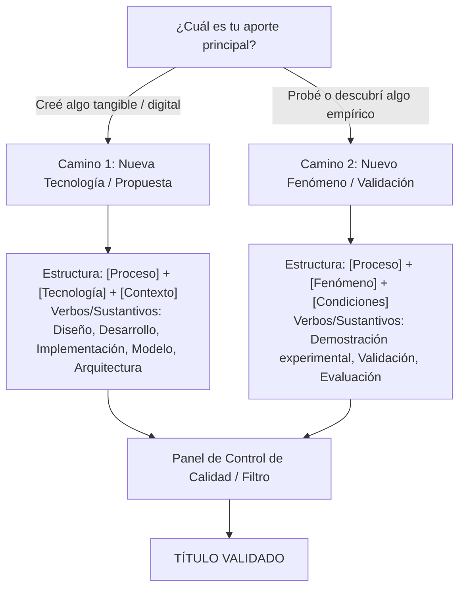

# Guía Estructural y Metodológica para la Formulación del Título de Tesis en Ingeniería y Ciencias

> **Fuente:** Diapositivas de cátedra *Seminario de Investigación II (Título de tesis)*  
> **Docente:** Msc. Raúl Huillca Huallparimachi  
> **Institución:** Universidad Nacional de San Antonio Abad del Cusco (UNSAAC)  
> **Facultad / Departamento:** Facultad de Ingeniería Eléctrica, Electrónica, Informática y Mecánica — Departamento Académico de Informática  
> **Fecha:** Cusco, 23 de septiembre de 2026

---

## 1. Principio Fundamental: Especificación Técnica, no Resumen

* **Definición:** Un título de tesis no es un titular periodístico ni un resumen condensado; es una **especificación técnica** y una **etiqueta de metadatos**.
* **Eficiencia pura:** El objetivo central es que cualquier investigador o revisor comprenda exactamente **qué se hizo y qué se logró** con solo leer el título (decodificación en menos de 3 segundos).
* **Preguntas obligatorias que debe responder al instante:**
  1. **¿Qué se estudia o se propone?**
  2. **¿Qué se quiere lograr con ello?**

---

## 2. La Ecuación Universal del Título

El título debe formularse siguiendo una estructura modular estricta:

$$\mathbf{Título = [Proceso] + [Tecnología / Método] + [Contexto / Aplicación]}$$

O en su versión de sintaxis de sistemas:

$$\mathbf{Título = [PROPUESTA] + [PROPÓSITO] + [OBJETO]}$$

| Módulo | Definición | Pregunta que responde | Ejemplos típicos |
| :--- | :--- | :--- | :--- |
| **PROPUESTA** / Proceso + Tecnología | La acción investigativa y el núcleo del aporte (software, hardware, algoritmo, arquitectura, material). | *¿Qué propongo o construyo?* | *Sistema inteligente*, *Diseño e implementación de un sistema de navegación autónomo basado en visión artificial*, *Modelo de arquitectura cuántico-clásica...* |
| **PROPÓSITO** | El objetivo técnico a lograr, problema a mitigar o variable dependiente. | *¿Para qué sirve? / ¿Qué efecto busco?* | *para la reducción del consumo de energía*, *para la optimización de tiempos de respuesta*, *para la detección temprana de fallas estructurales* |
| **OBJETO** / Contexto | El campo exacto, entorno, dataset, condiciones o dominio donde se aplica. | *¿Dónde o bajo qué condiciones se aplica?* | *en viviendas urbanas*, *en drones de rescate en zonas montañosas*, *en puentes de concreto*, *en modelos de aprendizaje automático* |

> **Regla de Compilación:** El orden de los bloques puede variar ligeramente según la fluidez sintáctica, pero **los tres módulos deben existir** para que el título "compile" correctamente.

---

## 3. Matriz Diagnóstica: Los Dos Caminos de Investigación

Antes de redactar, se debe definir el aporte principal de la investigación:

### Camino 1: Nueva Tecnología (Creación o Mejora Digital / Tangible)
* **Enfoque:** Creación, diseño o mejora sustancial de un software, hardware, arquitectura, modelo o material.
* **Verbos y sustantivos clave:** *Diseño*, *Desarrollo*, *Implementación*, *Modelo*, *Arquitectura*, *Sistema*, *Framework*.
* **Plantilla canónica:**
  $$\text{Desarrollo de [Nueva Tecnología] para la optimización de [Problema] en [Contexto]}$$
* **Ejemplos validados:**
  * `[Diseño e implementación] de [un sistema de navegación autónomo basado en visión artificial] para [drones de rescate en zonas montañosas].`
  * `[Desarrollo de] [un biomaterial compuesto de quitosano y grafeno] para [la regeneración de tejido óseo].`

### Camino 2: Demostración Experimental / Fenómenos (Análisis y Validación Empírica)
* **Enfoque:** Gran parte de la ciencia no inventa una tecnología nueva; analiza, valida o comprueba relaciones causa-efecto o desempeño empírico. Si este es el caso, **no puede iniciar con un sustantivo de construcción (ej. 'Sistema')**, sino con la acción investigativa real.
* **Verbos clave:** *Demostración experimental de*, *Validación de*, *Evaluación de*.
* **Plantilla canónica:**
  $$\text{Demostración experimental de [Fenómeno] mediante [Método/Tecnología] en [Condiciones]}$$
* **Ejemplos validados:**
  * `[Demostración experimental del] [incremento de eficiencia térmica] [en paneles solares mediante el uso de nanofluidos de alúmina].`
  * `[Validación de] [un algoritmo de aprendizaje profundo] [para la detección temprana de fallas estructurales en puentes de concreto].`

---

## 4. Matriz Taxonómica de Investigación

El título debe alinearse con precisión milimétrica al tipo específico de estudio:

| Tipo de Investigación | Pregunta Principal de la Tesis | Estructura Típica Recomendada | Ejemplo Ilustrativo (Caso Robot de Riego) |
| :--- | :--- | :--- | :--- |
| **Propuesta Tecnológica** | *¿Qué voy a construir?* | `[Modelo / Sistema X] para [Y]` | *"Sistema robótico para el riego automatizado..."* (Foco: El invento en sí). |
| **Desarrollo Tecnológico** | *¿Cómo construyo X?* | `Diseño e implementación de [X] para [Y]` | *"Diseño e implementación de un sistema robótico de riego..."* (Foco: Proceso de fabricación e ingeniería). |
| **Evaluación** | *¿Qué tan bien funciona X?* | `Evaluación de [X] para [Y]` | *"Evaluación del desempeño de un sistema robótico en el riego..."* (Foco: ¿Riega bien?, métricas operativas). |
| **Comparación** | *¿Cómo se comporta X frente a Z?* | `Comparación de [X] y [Z] para [Y]` | *"Comparación de sistemas robóticos convencionales frente a autónomos para riego..."* (Foco: Robot A vs. Robot B). |
| **Validación / Demostración** | *¿Funciona realmente X?* | `Demostración experimental de [X]` / `Validación de [X] para [Y]` | *"Demostración experimental de la reducción de consumo hídrico mediante robot..."* (Foco: Evidencia empírica). |

---

## 5. El Léxico Técnico de Creación

Cuando la tesis propone una solución técnica, se deben utilizar **sustantivos de construcción exactos**, evitando términos ambiguos:

* `[Modelo]`
* `[Método]`
* `[Algoritmo]`
* `[Arquitectura]`
* `[Sistema]`
* `[Framework]`
* `[Protocolo]`
* `[Técnica]`
* `[Esquema]`

---

## 6. Registro de Errores: Anti-Patrones a Evitar (Bugs Comunes)

| Código de Error | Nombre del Anti-Patrón | Descripción y Regla | ❌ Incorrecto | ✔️ Correcto |
| :--- | :--- | :--- | :--- | :--- |
| **Bug 01** | **El Tono Comercial** | Títulos informales que parecen eslóganes publicitarios o promesas de marketing. Deben reemplazarse por terminología técnica rigurosa. | *"Una forma más rápida de programar microcontroladores"* | *"Optimización del tiempo de ejecución en microcontroladores mediante..."* |
| **Bug 02** | **Código Cerrado (Abreviaturas)** | Uso de siglas no universales que solo el laboratorio entiende. Deben escribirse los términos completos. | *PCB*, *HMI* | *Printed circuit board* (tarjeta de circuito impreso), *Human-machine interface* (interfaz humano-máquina). |
| **Bug 03** | **Sobrecarga de Fórmulas Químicas** | Inclusión de fórmulas químicas crudas. Debe usarse el nombre del compuesto, salvo limitación crítica de espacio. | *CO2* | *Dióxido de carbono* |
| **Bug 04** | **La Falacia de lo "Nuevo"** | Palabras redundantes que debilitan el impacto científico (*Nuevo*, *Innovador*, *Novedoso*). La propia formulación del título ya implica que es un aporte inédito. | *"Nuevo modelo cuántico innovador para..."* | *"Modelo cuántico para..."* |
| **Bug 05** | **Frases de Relleno Analíticas** | Comienzos vagos o genéricos que diluyen la acción directa de la investigación. | *"Estudio sobre..."*, *"Investigación acerca de..."* | Ir directo a la acción: *"Análisis comparativo de..."*, *"Diseño e implementación de..."* |

---

## 7. Honestidad Estructural: Calibrando el Aporte Real

El título no debe inflar ni degradar el nivel real de contribución:

* **Si aplicaste un algoritmo existente:** ❌ NO digas *"Nuevo algoritmo para..."*. Debes indicar la adaptación, integración o evaluación en el contexto específico.
* **Si diseñaste un esquema integral completo de inicio a fin:** ❌ NO te limites a llamarlo *"Modelo para..."*. ✔️ Usa el término de mayor jerarquía: **`Arquitectura`**.
* **Si tu trabajo consistió en contrastar métodos existentes:** ❌ NO lo disfraces de propuesta tecnológica novedosa. Debes catalogarlo como *Comparación* o *Evaluación*.

---

## 8. Caso de Alta Complejidad Técnica (Ejemplo Paradigmático)

La estructura modular resiste incluso la mayor densidad de conceptos técnicos:

$$\underbrace{\text{[Modelo de arquitectura cuántico-clásica con cifrado homomórfico]}}_{\text{PROPUESTA (Qué propongo + Tecnología base)}} + \underbrace{\text{para el [entrenamiento y preservación de privacidad]}}_{\text{PROPÓSITO (El doble objetivo)}} + \underbrace{\text{en [modelos de aprendizaje automático]}}_{\text{OBJETO (Dónde se aplica)}}$$

> **Conclusión:** *Sin importar la densidad o sofisticación técnica de la investigación, la arquitectura base permanece inalterable.*

---

## 9. Checklist de Auditoría (Panel de Calidad Final)

Antes de dar por aprobado un título de tesis, debe verificarse cada uno de los siguientes puntos:

- [ ] **1. Identificación instantánea:** ¿Se reconocen a primera vista la **[PROPUESTA]**, el **[PROPÓSITO]** y el **[OBJETO]**?
- [ ] **2. Aporte real:** ¿El verbo o sustantivo inicial refleja honestamente la naturaleza de la investigación (Proponer vs. Desarrollar vs. Evaluar vs. Validar)?
- [ ] **3. Cero redundancias publicitarias:** ¿Se eliminaron modificadores como *"Nuevo"*, *"Innovador"*, *"Novedoso"* o frases como *"Estudio sobre..."*?
- [ ] **4. Claridad en siglas:** ¿Se erradicaron siglas oscuras o términos que no sean estándares internacionales abiertos?
- [ ] **5. Longitud óptima:** ¿El título tiene una longitud balanceada de **15 a 20 palabras** (evitando superar las 20 palabras)?
